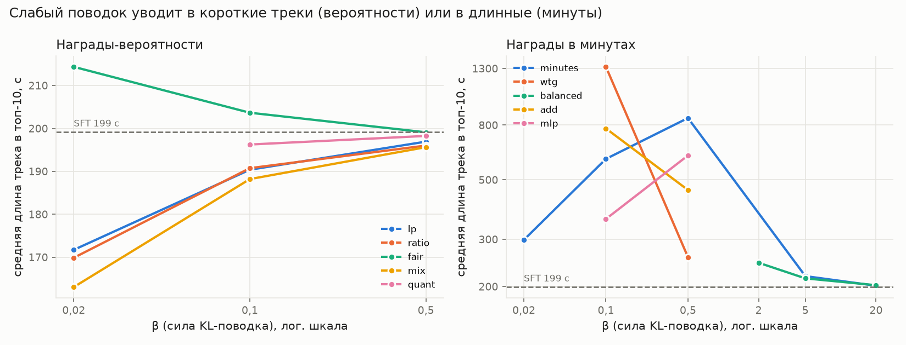
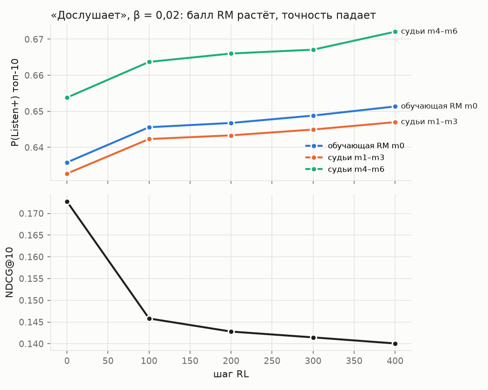
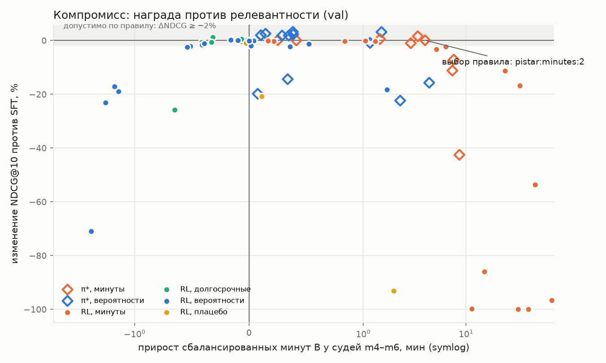

# RL-дообучение последовательного рекомендателя против модели вознаграждения (Yambda-50M)

Тестовое задание Т-Банка № 2. GPT-2 предсказывает следующий трек; модель вознаграждения (RM) предсказывает отклик; политику дообучаем RL против RM. Главный вопрос — становятся ли рекомендации от этого лучше по-настоящему или модель учится угождать RM.

> Числа val — полная оценка: 31 459 пользователь-дней (`artifacts/runs/eval/val/sft.json`), парный бутстрэп по пользователям, 7 членов RM. Числа OOT получены одним прогоном после заморозки (`artifacts/freeze.json`); они в разделе 8. Исключение — одна модель из 8.3: её выбрали после вскрытия OOT и прогнали на OOT вторым, помеченным прогоном. Сопоставление с условиями задания — `docs/assignment_check_RU.md`.

## 0. Коротко

1. **Сильнее всего на качество влияют повторы.** На val GPT-2 без канала повторов даёт NDCG@10 0,035, личный топ пользователя — 0,192. Канал повторов поднимает GPT-2 до 0,173, его усиление — до 0,202. Это сравнение важно: прирост после RL нужно отделять от простого сдвига к знакомым трекам (`artifacts/runs/eval/val/sft.json`, `artifacts/runs/eval/val/copyscale__4.json`; остальные модели — раздел 7.1).
2. **Повышение награды может ухудшать рекомендации.** При слабой KL-регуляризации RL выбирает короткие треки ради дослушивания или длинные ради минут. При этом падает NDCG и растёт концентрация выдачи. Поэтому правило выбора ограничивает потерю релевантности, пропуски, дослушивание и концентрацию; одного балла RM недостаточно (разделы 6 и 7.3).
3. **В одношаговом эксперименте лучше оказался пересчёт вероятностей, а не RL.** Для фиксированных RM и β оптимальное распределение имеет вид π\* ∝ π_ref · exp(r / β). В реализации переранжируется топ-1000 SFT. По правилу, зафиксированному на val, выбран вариант «минуты», β = 2: B +25% против +8% у лучшего допустимого RL. Это результат данной RM, сетки и набора кандидатов, а не общий вывод о ненужности RL (`artifacts/runs/eval/val/selection.json`).
4. **Прирост минут требует отдельной проверки длины.** У исходного выбора на OOT ΔB +3,99, а при подстановке привычной длины −0,23 [−0,25; −0,21]. Версия со штрафом за длину даёт ΔB +1,74 (+10,7%), но остаток без длины −0,01 [−0,02; +0,01]. Положительный эффект сверх удлинения не подтверждён. Версия со штрафом выбрана после первого OOT и показана отдельно как второй прогон (`artifacts/runs/eval/oot/diag/diag.json`, разделы 8.1–8.3).

Пять шагов вперёд не устранили проблему: на сгенерированной истории балл RM растёт, хотя релевантность падает (раздел 9). Рост удержания и удовлетворённости этими опытами не установлен; следующий этап — проверить обновлённую RM и провести A/B с защитой от изменения привычной длины.

## 1. Постановка

- **Продуктовая рамка** — «Моя волна»: сервис сам ставит следующий трек.
- **Политика** π_θ(a | s) — GPT-2 по истории прослушиваний. Токены — 100 тыс. самых частых треков; к ним добавляются эмбеддинги исхода, органики и интервала.
- **RM** r(s, a) — по истории и треку-кандидату предсказывает отклик.
- **RL** максимизирует E[Σ_t r(s ⊕ a_<t, a_t)] − β · Σ_t KL(π_θ ‖ π_ref):
  - T = 1 — следующий трек;
  - T = 5 — последовательность; сгенерированный трек дописывается в контекст с исходом «неизвестно».

Почти половина прослушиваний органические, остальные треки выбрала рекомендательная система. Поэтому SFT воспроизводит и выбор пользователя, и рекомендации прежней системы. Релевантность меряем не по следующему событию, а по множеству треков, которые пользователь дослушал в день оценки.

## 2. Данные

[Yambda-50M](https://huggingface.co/datasets/yandex/yambda): 10 000 пользователей во всех типах событий, из них 9 238 с прослушиваниями; 46,5 млн прослушиваний, 301 день (`artifacts/source_summary.json`). Используются `played_ratio_pct`, длина трека, лайки и дизлайки, флаг органики.

Ловушка из условия видна в самих данных (алгоритмические прослушивания):

| Длина трека | Доля дослушивания | Listen+ (≥ 50%) | Прослушано секунд |
|---|---|---|---|
| ≤ 90 с | 0,79 | 0,78 | 59 |
| 150–200 с | 0,71 | 0,69 | 127 |
| 250–330 с | 0,66 | 0,64 | 184 |
| > 480 с | 0,56 | 0,54 | 407 |

Доля дослушивания тянет к коротким трекам, секунды — к длинным.

## 3. Разбиение и защита от утечек

| Часть | Дни | Зачем |
|---|---|---|
| Обучение | 0–286 | SFT, RM, словарь, статистики |
| Состояния RL | снимки начала дней 273–286 | только контексты, без меток |
| val | 287–293 | все решения |
| OOT | 294–300 | один прогон замороженных моделей, без переобучения |

- **Контекст** пользователь-дня — только события до начала дня, как в Global Temporal Split статьи Yambda.
- **Метки RM с горизонтом** (лайк за 24 ч, продолжение за 30 минут, «открытие» за 7 дней) берутся только у событий, чей горизонт закрыт до отсечки.
- **Тесты** (`tests/test_no_leakage.py`, 6 из 6):
  - контекст строго до дня;
  - выход политики не меняется при перемешивании будущих событий;
  - словарь только по дням обучения;
  - горизонт меток закрыт;
  - признаки RM совпадают при обучении и применении;
  - цели дня — ровно Listen+ этого дня.
- **Проверки протокола** (`tests/test_protocol.py`): неизвестные кандидаты, изменение хэша, неполный результат и потеря пометки второго прогона отклоняются. Сохранённый результат не запускает модель повторно.
- **OOT** запускается только при наличии `artifacts/freeze.json` (коммит, пороги, хэши всех чекпойнтов, состав) и не перезаписывается.

## 4. Модели

**SFT.** GPT-2, 4 слоя, d = 256, окно 256.
- Вход позиции — эмбеддинги трека, исхода (пропуск / частично / Listen+ / неизвестно), органики и интервала; выход связан с эмбеддингами треков.
- Кросс-энтропия по всему словарю кусками с пересчётом в обратном проходе.
- **Канал повторов:** логит(v) += w₀ · log1p(число v в контексте) + w₁ · log1p(число v в последних 32 событиях). Веса учатся, итог (2,3; 0,7).

**RM.** Бэкбон GPT-2 (инициализирован весами SFT) + MLP([h, e, h ⊙ e, side]).
- 6 голов: доля дослушивания, Listen+, пропуск, лайк, продолжение сессии, «открытие» артиста.
- Признаки side: длина и популярность трека, сколько раз пользователь слушал трек и артиста, сглаженные доли Listen+ и пропусков пары «пользователь × трек» (сильнейшие признаки в задании 1), доля Listen+ артиста.

**Ансамбль из 7 членов, на разных 80% пользователей:**
- m0 учит политику;
- судьи m1–m3 обучены так же, как m0 — на окнах с исходами этого же дня;
- судьи m4–m6 обучены на снимке начала дня, то есть так, как RM применяется в RL.

**RL.** REINFORCE с leave-one-out бейзлайном (RLOO), G = 16 сэмплов на состояние, точный KL по всему словарю, строго on-policy, 400 шагов (для `spotify`, T = 5 — 200).
- Без деления преимущества на std, поэтому стационарная точка при T = 1 — ровно π\*_β, и β сравним с закрытой формой.
- При T = 5 — накопление градиента по целым состояниям. KL вычисляется точно в каждом посещённом состоянии; при этом градиент изменения распределения будущих состояний для KL не учитывается. Это приближение, а не точный градиент полной цели по траектории.

## 5. Награды

| Код | Награда | Откуда |
|---|---|---|
| `lp`, `ratio` | P(Listen+), ожидаемая доля дослушивания | условие задания |
| `fair` | Listen+ минус средняя Listen+ для такой длины | наша поправка |
| `cont` | P(сессия продолжится) | долгосрочная цель |
| `disc` | Listen+ + 2 · P(открытие нового артиста) | долгосрочная цель |
| `minutes` | ожидаемые минуты; для T = 5 — Σ_t Π_{k<t} P(cont_k) · минуты_t | метрика эксперимента |
| `balanced` | прирост сбалансированных минут B (раздел 6) | метрика эксперимента |
| `mlp` | Z(минуты) + Z(Listen+) | бонус за дослушивание |
| `wtg` | (L · ratio − μ_b) / σ_b, стандартизация в корзине длины | Zheng et al., MM'22 |
| `quant` | процентиль предсказанной доли среди треков той же длины | по мотивам D2Q, Zhan et al., KDD'22 |
| `add` | Z(минуты) + 0,25 · Z(лайк) − 0,25 · Z(пропуск) | по схеме FeedRec, KDD'19 |
| `spotify` | (1 − skip) − 0,1 + 0,1 · (1 − skip) · разнообразие | Hansen et al., WSDM'21 |
| `mix` | Listen+ + 0,5 · лайк − 0,5 · пропуск | порядок исходов как в ARGUS (Яндекс) |
| `placebo` | фиксированное случайное число на трек | контроль |

## 6. Дерево метрик и правило выбора

Зафиксированы до полной оценки и OOT: `docs/metrics_hypotheses_RU.md`.

**Главная метрика** — сбалансированные минуты на пользователя в неделю: **B = T · K(s)**.
- T — минуты; s — доля новой музыки (треки, которых человек не слышал, артист неважен).
- K = BC² при s ≤ s\* и 1 − 0,25 · (1 − BC²) при s > s\*, где BC = √(s · s\*) + √((1 − s)(1 − s\*)) и s\* = 0,278 — доля новой музыки в обучении.
- Свойства: B ≤ T, равенство ровно при целевой доле; метрика читается в минутах и растёт без потолка; избыток нового штрафуется вчетверо мягче недобора. Штраф: без нового −27,8%, 50/50 −1,3%.
- Офлайн в таблицах показан вклад предложенной сессии в B: B(прошлая неделя + топ-10) − B(прошлая неделя), с поправкой на вероятность продолжения сессии. Например, уровень 16,21 у SFT — модельный вклад этой сессии, а не все минуты пользователя за неделю. ΔB — разница этого вклада против SFT (`src/rlrec/evaluate.py`).

**Вторичные метрики:** минуты, сессии в неделю, открытие артистов.

**Правило выбора:** максимум прироста B у судей m4–m6 при пяти ограничениях против SFT:
1. NDCG@10 не «хуже» и Δ ≥ −2%;
2. Recall@100 на новых треках Δ ≥ −10%;
3. P(пропуск) не выше SFT больше чем на 0,005;
4. доля самого частого трека ≤ 2 × SFT;
5. P(Listen+) не ниже SFT больше чем на 0,005.

## 7. Результаты на val

### 7.1. Базовые модели

| Модель | NDCG@10 | Recall@100 | Recall@100 (новые треки) | Повторы в топ-10 |
|---|---|---|---|---|
| MostPop (7 дней) | 0,020 | 0,057 | 0,046 | 30% |
| Личный топ (Listen+ за 30 дней) | 0,192 | **0,304** | 0,012 | 98% |
| SFT без канала повторов | 0,035 | 0,088 | **0,038** | 62% |
| **SFT с каналом повторов** (π_ref) | 0,173 | 0,237 | 0,018 | 98% |
| SFT, канал повторов × 2 | 0,192 | 0,264 | 0,008 | 100% |
| SFT, канал повторов × 4 | **0,202** | 0,271 | 0,005 | 100% |

Близкая картина есть в литературе на данных Яндекс Музыки: Personalized Most Popular 0,183, SASRec 0,103, SASRec с персональной популярностью 0,165 ([Abbattista et al., RecSys'24](https://arxiv.org/abs/2409.04329)). Обучение next item недооценивает повторы относительно дневной метрики: выученный вес канала (2,3) меньше оптимального для NDCG.

### 7.2. Модель вознаграждения

617 тыс. алгоритмических прослушиваний val:

| | AUC Listen+ | GAUC внутри пользователь-дня | AUC пропуска | AUC лайка | AUC продолжения | AUC открытия |
|---|---|---|---|---|---|---|
| m0 на логе (с исходами этого дня) | 0,905 | 0,651 | 0,912 | 0,818 | 0,657 | 0,719 |
| m0 на снимке начала дня (как в RL) | 0,778 | 0,578 | 0,777 | 0,785 | 0,613 | 0,700 |
| Судьи m4–m6 на снимке | 0,822 | 0,577 | 0,825 | 0,789 | 0,596 | 0,693 |
| Средняя Listen+ пользователя / трека | 0,804 / 0,645 | 0,500 / 0,545 | | | | |

- Без исходов текущего дня качество RM заметно ниже. Результат согласуется с Spotify Skip Prediction (Brost et al., WWW'19), где отклик на предыдущий трек помогает предсказать пропуск следующего.
- m0 на снимке завышает вероятность дослушивания: предсказанные 0,96 → фактические 0,91.
- У судей m4–m6 предсказания в приведённых интервалах ближе к наблюдаемой частоте: 0,95 → 0,954, 0,45 → 0,457. Их оценки отличаются от m0 впятеро сильнее, чем оценки m1–m3 (разброс 0,051 против 0,011).
- GAUC 0,58 сопоставим с бустингом задания 1 (0,587). Внутри пользователя RM различает треки слабо, поэтому сигнал для RL слабый.

### 7.3. RL: награда против релевантности

Срез ключевых прогонов (T = 1, шаг 400). Полная таблица — `artifacts/runs/eval/val/compare_balanced.json` и соседние JSON сравнения других наград.

| Награда, β | NDCG@10 | Δ NDCG | P(Listen+) судей m4–m6 | B судей | Средняя длина, с | Самый частый трек | Повторы |
|---|---|---|---|---|---|---|---|
| SFT | 0,173 | — | 0,654 | 16,1 | 199 | 4,1% | 98% |
| lp, 0,5 | 0,173 | +0,2% | 0,656 | 16,0 | 197 | 4,5% | 99% |
| lp, 0,1 | 0,170 | −1,6% | 0,662 | 15,7 | 190 | 5,8% | 98% |
| lp, 0,02 | 0,140 | −19% | 0,672 | 14,6 | 172 | 13,5% | 90% |
| lp, 0 | 0,050 | −71% | **0,705** | 13,4 | 127 | 76% | 40% |
| fair, 0,02 | 0,141 | −18% | 0,651 | 17,8 | 214 | 10,3% | 90% |
| cont, 0,1 | 0,172 | −0,2% | 0,654 | 16,0 | 198 | 4,1% | 98% |
| disc, 0,02 | 0,128 | −26% | 0,653 | 15,4 | 168 | 22% | 74% |
| minutes, 5 | 0,172 | −0,2% | 0,650 | 17,4 | 219 | 3,6% | 98% |
| minutes, 0,5 | 0,080 | −54% | 0,556 | 63,0 | **850** | 70% | 31% |
| minutes, 0,1 | 0,000 | −100% | 0,570 | 48,2 | 598 | 100% | 0% |
| wtg, 0,5 | 0,169 | −2,3% | 0,649 | 22,4 | 257 | 11% | 87% |
| wtg, 0,1 | 0,006 | −97% | 0,474 | 84,2 | **1 319** | 94% | 6% |
| add, 0,5 | 0,153 | −11% | 0,621 | 40,0 | 458 | 21% | 77% |
| mlp, 0,5 | 0,144 | −17% | 0,602 | 49,5 | 616 | 35% | 64% |
| balanced, 5 | 0,173 | −0,1% | 0,650 | 17,1 | 215 | 3,9% | 98% |
| balanced, 2 | 0,167 | −3,3% | 0,643 | 21,2 | 245 | 9,4% | 90% |
| quant, 0,1 | 0,169 | −2,0% | 0,660 | 16,1 | 196 | 7,0% | 97% |
| mix, 0,02 | 0,133 | −23% | 0,677 | 14,1 | 163 | 16% | 86% |
| placebo, 0,1 | 0,137 | −21% | 0,639 | 16,2 | 201 | 12,6% | 87% |
| placebo, 0,02 | 0,012 | −93% | 0,569 | 18,0 | 211 | 74% | 32% |





- При слабой KL-регуляризации RL повышает награду ценой NDCG. Короткие треки — у наград-вероятностей (lp, ratio, mix), длинные — у наград в минутах (minutes, wtg, add, mlp).
- Взлом не виден самим RM. При β = 0 у «дослушает» все судьи ставят выдаче более высокую P(Listen+) (0,705 против 0,654), хотя NDCG упал на 71%. Проверка судьёй другой архитектуры — в разделе 7.6.
- При одинаковом β сдвиг зависит от масштаба и разброса награды между треками.
  - Плацебо при β = 0,1 уходит дальше настоящих наград, его KL втрое выше.
  - Награды в минутах при β = 0,5 схлопываются, а вероятности при том же β почти не двигаются.
- Дальнейшее ослабление KL может уменьшить и саму награду. У «минут» при β = 0,1 и 0,02 итоговые минуты ниже, чем при β = 0,5: оптимизация застревает в вырожденных решениях из 24–33 треков на всех.
- Долгосрочные награды на уровне трека. `cont` почти константа (P ≈ 0,94) и не двигает политику. `disc` при слабой KL-регуляризации схлопывает выдачу в «открывающие» треки для всех.

### 7.4. Закрытая форма π\* против RL

π\*_β ∝ π_ref · exp(r / β), та же RM m0. При T = 1 формула задаёт точный оптимум цели с фиксированной наградой. Здесь она применяется на топ-1000 SFT; оптимальность по всему словарю не проверяется. Дополнительное обучение не требуется.

| | NDCG@10 | Recall@100 | P(Listen+) судей m4–m6 | B судей | Длина, с |
|---|---|---|---|---|---|
| SFT | 0,173 | 0,237 | 0,654 | 16,1 | 199 |
| π\* lp, 0,1 | **0,178** | **0,261** | 0,700 | 16,5 | 191 |
| RL lp, 0,1 | 0,170 | 0,230 | 0,662 | 15,7 | 190 |
| π\* fair, 0,1 | 0,178 | 0,261 | 0,695 | 17,6 | 205 |
| π\* minutes, 2 | 0,173 | 0,240 | 0,652 | **20,1** | 253 |
| π\* minutes, 5 | 0,174 | 0,239 | 0,654 | 17,5 | 218 |
| RL minutes, 5 | 0,172 | 0,237 | 0,650 | 17,4 | 219 |
| π\* balanced, 5 | 0,171 | 0,228 | 0,652 | 19,0 | 223 |
| RL balanced, 5 | 0,173 | 0,235 | 0,650 | 17,1 | 215 |
| π\* wtg, 0,5 | 0,176 | 0,251 | 0,670 | 19,5 | 243 |



**Различия методов:**
- π\* пересчитывает вероятности в топ-1000 SFT по оценкам RM, которая учитывает историю пары «пользователь × трек». Для награды «дослушает» в этой сетке растут и NDCG, и награда.
- RL делает то же градиентами по 16 сэмплам из 100 тыс. действий за 400 шагов и не доходит до оптимума. Недобор β · KL(π_RL ‖ π\*) — в разделе 7.5.
- При одинаковом β RL достигает 80–90% прироста π\* для «минут», а для «дослушает» уходит в противоположную сторону по точности.

### 7.5. Выбор точки, разложение прироста и недобор RL

**Правило выбора.** Ограничения прошли 23 кандидата из 69. **Выбрана π\* «минуты», β = 2**:
- B +3,99 [+3,77; +4,22] (+25% к SFT), минуты сессии +3,97;
- NDCG@10 +0,1%, новые треки +1,0%;
- P(пропуск) +0,0015, P(Listen+) −0,002;
- самый частый трек 3,2%.

Следующие места:
- π\* WTG, 0,5: B +3,39, NDCG +1,6%;
- π\* fair, 0,1: B +1,51, NDCG +3,2%;
- лучший RL — «минуты», 5: B +1,31, NDCG −0,2%.

Плата за выбранную точку — треки на 27% длиннее. Уход от личного профиля длины (|Δ log-длины|) — 0,167 против 0,111 у SFT. Ограничением это не было, поэтому отмечаем как риск для A/B.

**Разложение прироста** (`scripts/decompose.py`). Изменение P(Listen+) судей m1–m3 по топ-10 делится на две части:
- «состав» — сдвиг долей между группами (повтор / новый × корзина длины × терциль популярности);
- «внутри групп» — лучшие треки той же группы.

| | Δ P(Listen+) | Состав | Внутри групп | Короткие (≤ 150 с) в топ-10 | Повторы |
|---|---|---|---|---|---|
| π\* lp, 0,1 | +0,051 | +0,003 | **+0,047** | 0,22 → 0,25 | 0,98 → 0,99 |
| RL lp, 0,1 | +0,008 | +0,003 (длина +0,003) | +0,005 | 0,22 → 0,25 | 0,98 |
| RL lp, 0,02 | +0,014 | +0,005 (длина +0,011, повторы −0,006) | +0,010 | 0,22 → **0,38** | 0,98 → 0,90 |
| RL lp, 0 | +0,010 | −0,006 (длина **+0,032**, повторы **−0,043**) | +0,016 | 0,22 → **0,83** | 0,98 → **0,40** |
| RL mix, 0,02 | +0,015 | +0,006 (длина +0,014, повторы −0,009) | +0,010 | 0,22 → 0,46 | 0,98 → 0,86 |

- π\* выигрывает за счёт лучших треков внутри тех же групп (94% прироста), состав выдачи почти не меняется.
- У RL сдвиг к коротким трекам даёт +0,01…+0,03 к баллу, но одновременно уменьшается доля повторов, у которых дослушивание выше. Эти изменения частично компенсируются: гипотеза H4 («больше половины прироста — состав») по агрегату не подтвердилась.
- Прирост «внутри групп» тоже посчитан модельными судьями. Они относятся к тому же семейству RM. Проверка внешним судьёй приведена в 7.6.

**Недобор RL до оптимума** (`scripts/suboptimality.py`). На топ-1000 SFT сравниваем ожидаемую награду π_ref, π_RL и π\*_β при той же RM m0. Недобор J(π\*) − J(π_RL) = β · KL(π_RL ‖ π\*) (Rafailov et al., приложение A.1).

| Награда | Доля достижимого прироста, которую взял RL, при β = 0,5 / 0,1 / 0,02 | β · KL(π_RL ‖ π\*) |
|---|---|---|
| lp | 36% / 25% / 25% | 0,015 / 0,026 / 0,073 |
| ratio | 38% / 26% / 25% | 0,013 / 0,022 / 0,064 |
| fair | 34% / 23% / 22% | 0,015 / 0,026 / 0,077 |
| mix | 34% / 23% / 27% | 0,019 / 0,042 / 0,104 |
| minutes (β = 20 / 5) | 53% / 79% | 0,25 / 0,13 |
| balanced (β = 20 / 5 / 2) | 23% / 17% / 11% | 0,37 / 0,36 / 1,32 |
| **плацебо** | **91% / 79% / 83%** | 0,019 / 0,026 / 0,100 |

- Гипотеза H6 подтверждена: RL всегда недобирает до закрытой формы, и тем сильнее, чем слабее KL-регуляризация.
- Для осмысленных наград RL берёт около четверти достижимого, для случайной — 80–90%. Возможное объяснение — слабое различение треков одного пользователя (GAUC 0,58) и шум оценки REINFORCE по 16 сэмплам на 100 тыс. действий. У плацебо разброс награды между треками больше. Отдельного эксперимента, разделяющего эти причины, не было.
- Оговорка: у SFT в собственном топ-1000 лишь ~50% вероятности (распределение плоское). Для схлопнувшихся прогонов (1–16% массы в топ-1000) это сравнение неинформативно.

### 7.6. Внешний судья: бустинг задания 1

LightGBM B0 из задания 1 оценивает топ-10 тех же моделей на 3 936 пользователь-днях. Он обучен на залогированных показах дней 273–286 по снимку начала дня и предсказывает P(Listen+). Это другое семейство моделей.

| Модель | P(Listen+) по бустингу | Δ к SFT [95% CI] | NDCG@10 |
|---|---|---|---|
| SFT | 0,657 | — | 0,173 |
| Личный топ | 0,704 | +0,047 [+0,045; +0,049] | 0,192 |
| π\* lp, 0,1 | 0,701 | +0,044 [+0,043; +0,046] | 0,178 |
| π\* wtg, 0,5 | 0,672 | +0,015 [+0,014; +0,017] | 0,176 |
| RL mix, 0,1 | 0,665 | +0,008 [+0,008; +0,009] | 0,169 |
| RL lp, 0,1 | 0,664 | +0,007 [+0,007; +0,008] | 0,170 |
| RL lp, 0,02 | 0,676 | +0,019 [+0,017; +0,020] | 0,140 |
| **RL lp, 0 (коллапс)** | **0,739** | +0,082 [+0,079; +0,086] | **0,050** |
| π\* minutes, 2 (выбор) | 0,655 | −0,002 [−0,003; −0,001] | 0,173 |
| RL balanced, 5 | 0,653 | −0,004 [−0,004; −0,003] | 0,173 |
| RL minutes, 0,5 (коллапс) | 0,572 | −0,085 [−0,087; −0,083] | 0,080 |

ДИ — парный бутстрэп по пользователь-дням из сохранённых оценок, 1 000 повторов, seed = 0. Агрегаты и параметры — `artifacts/runs/eval/val/booster_judge_b0_summary.json`. ДИ пересчитаны при подготовке сдачи; новых оценок моделей нет.

- Внешний судья тоже высоко оценивает выдачу из коротких треков, у которой упала релевантность. Значит, проблема не ограничивается одной обучающей RM. Наблюдаемая связь длины с дослушиванием сама по себе не характеризует полезность рекомендации.
- Одной вероятности дослушивания недостаточно. Она может расти при ухудшении релевантности. В этих экспериментах падение видно по совпадению с логом и концентрации выдачи; эти показатели включены в правило выбора как ограничения.
- Гипотеза H9 подтвердилась лишь в части согласия судей при умеренном β. При β = 0,02 и 0 бустинг не «разоблачает» RL, а соглашается с RM.
- Выбранная точка (π\* minutes, 2) по бустингу на 0,002 ниже SFT по дослушиванию — в пределах ограничения правила; это цена более длинных треков.

### 7.7. Итог по гипотезам (зафиксированы до полной оценки)

| № | Гипотеза | Итог на val |
|---|---|---|
| H1 | При β = 0,5 NDCG «сопоставимо», при β = 0,02 «хуже» для lp, ratio, fair, disc | **да** |
| H2 | Балл судей растёт меньше обучающего, разрыв растёт с KL | **нет**: судьи (и m1–m3, и m4–m6) соглашаются с обучающей RM. Взлом не в ошибке RM, а в самой цели (7.6) |
| H3 | lp и ratio укорачивают треки, minutes удлиняет, fair перекорректирует в длинные | **да** (рис. 1) |
| H4 | При β ≤ 0,1 больше половины прироста — «состав» | **нет** по агрегату (около трети): сдвиг к коротким даёт +0,01…+0,03, но его гасит потеря повторов |
| H5 | Коллапс только у placebo и disc при β = 0,02 | **частично**: коллапсов больше — lp при β = 0, все награды в минутах при β ≤ 0,5, wtg / add / mlp при 0,1–0,5 |
| H6 | При T = 1 RL не обгоняет π\*, недобор растёт при меньшем β | **да**: RL берёт около четверти достижимого прироста |
| H7 | cont не двигает политику; сессионные минуты при T = 5 лучше минут за трек | cont — **да** (KL ≤ 0,04); T = 5 — **нет**: B у T = 5 ниже, чем у T = 1 при том же β |
| H8 | В открытом цикле точность падает, неуверенность растёт, на выдуманном контексте балл RM завышен | **частично**: точность падает и балл завышен, но разброс ансамбля падает |
| H9 | Бустинг-судья соглашается с RM при β ≥ 0,1 и разоблачает RL при β = 0,02 | **нет** во второй части: бустинг тоже ставит коллапсу высокий балл |
| H10 | Офлайн-прирост рекомендуемой точки < 5% и офлайн не проверяем | **нет / да**: прирост B у судей +25%, но это оценка RM; онлайн для +5% нужно ≥ 5,4 тыс. пользователей на группу |

## 8. OOT (дни 294–300, один прогон)

Заморожено 2026-10-25 02:00:55, коммит `d9e56ed69d`. В `artifacts/freeze.json` записаны пороги, хэши всех 7 RM и чекпойнтов RL и состав прогона: выбранная правилом точка + 18 фиксированных моделей для сравнения. Модели не переучивались, поэтому разрыв с обучением на OOT 8–14 дней.

| Модель | NDCG@10 | Вердикт | B судей m4–m6 | Δ B | P(пропуск) | P(Listen+) | Самый частый трек | Длина, с |
|---|---|---|---|---|---|---|---|---|
| SFT | 0,163 | — | 16,21 | — | 0,232 | 0,661 | 3,5% | 199 |
| **π\* minutes, 2 — выбор правила** | 0,163 (−0,3%) | сопоставимо | **20,20** | **+24,6%** | 0,234 | 0,659 | 3,0% | 252 |
| π\* wtg, 0,5 | 0,166 (+1,5%) | лучше | 19,57 | +20,7% | 0,219 | 0,677 | 3,7% | 241 |
| π\* lp, 0,1 | 0,169 (+3,7%) | лучше | 16,60 | +2,4% | 0,195 | 0,708 | 4,4% | 190 |
| RL balanced, 5 | 0,162 (−0,6%) | | 17,22 | +6,2% | 0,235 | 0,657 | 3,4% | 214 |
| RL lp, 0,1 | 0,160 (−1,8%) | | 15,82 | −2,4% | 0,225 | 0,669 | 5,4% | 190 |
| RL lp, 0,02 | 0,131 (−19%) | | 14,76 | −8,9% | 0,215 | 0,679 | 12,4% | 171 |
| RL lp, 0 | 0,045 (−72%) | | 13,49 | −17% | 0,180 | 0,714 | 78% | 126 |
| RL minutes, 0,5 | 0,074 (−55%) | | 64,26 | ×4 | 0,294 | 0,563 | 70% | 858 |
| Личный топ | 0,185 (+13%) | лучше | 16,93 | +4,4% | 0,198 | 0,702 | 8,7% | 196 |
| SFT, канал повторов × 4 | **0,191 (+17%)** | лучше | 16,40 | +1,2% | 0,234 | 0,658 | 3,4% | 202 |

- На OOT сохранились основные наблюдения с val: соотношение награды, NDCG и длины треков.
- Выбранная точка проходит все пять ограничений на неделе, которая не участвовала ни в одном решении:
  - B +24,6% (на val +25%);
  - NDCG «сопоставимо»;
  - пропуски +0,002;
  - Listen+ −0,002;
  - новые треки −1,2%;
  - концентрация ниже SFT.
- Цена та же, что на val: треки на 27% длиннее, уход от личного профиля длины — 0,168 против 0,112. Это главный риск для A/B; защищать его стоит отдельной метрикой «длина против привычной пользователю».
- RL по-прежнему проигрывает закрытой форме, а взломы при слабой KL-регуляризации воспроизводятся.
- Внешний судья на OOT — бустинг задания 1, его OOT-модель обучена на днях 280–293, 4 062 пользователь-дня (`artifacts/runs/eval/oot/booster_judge_b0_summary.json`). Даёт P(Listen+) относительно SFT (0,673):
  - π\* lp, 0,1: +0,041 [+0,039; +0,042];
  - личный топ: +0,040;
  - RL lp, 0,1: +0,006;
  - **коллапс RL lp, 0: +0,070** — бустинг также высоко оценивает короткие треки;
  - выбранная π\* minutes, 2: −0,001 [−0,002; −0,001];
  - RL balanced, 5: −0,003.

### 8.1. После вскрытия OOT: откуда прирост B

План, гипотезы и шестое ограничение записаны до расчётов: `docs/post_oot_diagnostics_RU.md`, коммит `b232527`. Всё в 8.1–8.3 — диагностика после вскрытия OOT, а не часть замороженного правила. Числа лежат в `artifacts/runs/eval/val/diag/diag.json` и `artifacts/runs/eval/oot/diag/diag.json`, скрипт — `scripts/diagnostics.py`.

**B с нейтральной длиной.** Тот же B судей m4–m6, только каждому рекомендованному треку подставлена привычная длина пользователя (среднее log длины треков, которые он слушал до дня). Остаток показывает разницу при этой подстановке. Это модельная диагностика, а не причинное разложение онлайн-эффекта. Числа OOT:

| Модель | Длина, с | ΔB | ΔB при нейтральной длине |
|---|---|---|---|
| SFT (уровень) | 199 | 16,21 | 16,32 |
| **π\* minutes, 2 — выбор правила** | 252 | +3,99 [+3,74; +4,24] | **−0,23** [−0,25; −0,21] |
| π\* wtg, 0,5 | 241 | +3,36 | +0,25 |
| RL balanced, 5 | 214 | +1,01 | −0,13 |
| RL minutes, 0,5 (коллапс) | 858 | +48,1 | −1,17 |
| π\* lp, 0,1 | 190 | +0,39 | +1,03 |
| RL lp, 0 (коллапс) | 126 | −2,72 | +5,16 |
| MostPop | 156 | −1,73 | +1,79 |

На val то же: у выбранной точки −0,24 вместо +3,99.

- Гипотеза D-H1 поддерживается диагностикой выбранной точки. При нейтральной длине весь положительный прирост исчезает: остаток −0,23 [−0,25; −0,21]. Это не общий вывод для всех наград: например, у π\* wtg, 0,5 остаток +0,25.
- Без длины B растёт у моделей с короткими треками и с большей долей нового: π\* lp, коллапс RL lp, MostPop. Коэффициент баланса поощряет новое, потому что у пользователей его меньше целевых 27,8%. Поэтому B судей — слабый офлайн-заменитель: при нейтральной длине даже MostPop «лучше» SFT, хотя по логу хуже на 46–89% (8.2).
- Разложение минут по корзинам длины грубее. У выбранной точки «состав» даёт 0,24 из 0,40 минуты на трек. Часть остатка «внутри корзин» может быть связана с длиной внутри широкой корзины; само разложение этого не отделяет. Поэтому отдельно показан пересчёт с нейтральной длиной.

### 8.2. Судьи ближе к «понравилось»

Δ к SFT на OOT (`artifacts/runs/eval/oot/diag/diag.json`). Две последние колонки посчитаны прямо по логу, без моделей.

| Модель | P(лайк) − норма для длины | Listen+ − норма для длины | NDCG@10 по лайкнутым за день | Доля реальных минут дня в топ-10 |
|---|---|---|---|---|
| SFT (уровень) | −0,003 | −0,020 | 0,0129 | 11,8% |
| SFT, канал повторов × 4 | −0,0005 | −0,001 | **+22%**, лучше | **+19%**, лучше |
| Личный топ | −0,0005 | +0,040 | −4% | +6%, лучше |
| π\* lp, 0,1 | −0,0005 | +0,044 | +0,1% | +1,1%, лучше |
| π\* minutes, 2 — выбор правила | +0,0004 | +0,010 | +1,3% | +2,3%, лучше |
| π\* minutes, 2, штраф λ = 2 (8.3) | 0,0000 | +0,011 | +5% | +1,8%, лучше |
| RL balanced, 5 | +0,0002 | 0,000 | +6%, лучше | +0,2% |
| RL lp, 0 (коллапс) | **+0,006** | +0,012 | **−63%**, хуже | **−73%**, хуже |
| RL minutes, 0,5 (коллапс) | **+0,018** | −0,052 | **−43%**, хуже | **−50%**, хуже |

Модельные колонки — судьи m4–m6. «Норма для длины» — доля лайков или Listen+ у треков той же корзины длины в обучении. Val также показывает провал обоих коллапсов по R1 и R2; величины эффектов и отдельные вердикты отличаются (`artifacts/runs/eval/val/diag/diag.json`).

- Логовые метрики ловят оба коллапса: NDCG по лайкнутым −63% и −43%, реальные минуты −73% и −50%. Гипотеза D-H2 подтвердилась.
- Предсказание лайка тоже не выявляет падение NDCG. Оба коллапса получают вердикт «лучше» и наибольший прирост этой оценки в таблице. Listen+ с поправкой на длину показывает ухудшение только у коллапса в длинные треки.
- По принятому правилу гипотеза D-H3 не подтвердилась. У выбранной точки оба модельных судьи формально «лучше», но P(лайк) +0,0004 — примерно в 12 раз меньше порога 0,005. По коду `verdict` ДИ целиком выше нуля получает «лучше»; порог применяется только при пересечении нуля.
- В этой диагностике усиление канала повторов без RM даёт наибольший прирост по двум метрикам лога: +19% доли минут дня в топ-10 и +22% NDCG по лайкнутым. Для переранжирования по RM прирост доли минут относительно SFT составляет 1–2%. Это пересечение с наблюдённым логом; сколько человек слушал бы новую выдачу, неизвестно.
- Дизлайки редки. У SFT ранее дизлайкнуты 0,44% треков топ-10; у моделей без коллапса, кроме голой GPT-2 и MostPop, изменения около 0,1 п. п. или меньше. Это не означает равенства: отдельные ДИ исключают ноль. Здесь R3 меньше — лучше (`artifacts/runs/eval/oot/diag/diag.json`).

### 8.3. Исправление: штраф за отход от привычной длины

score = log π_ref + r / β − λ · |log L − log L_u|, награда «минуты», β = 2. Шестое ограничение: уход от профиля длины ≤ 1,1 × SFT, то есть 1,1 × 0,111 = 0,122 на val (расчёт по неокруглённым значениям `artifacts/runs/eval/val/sft.json`). Таблица — `artifacts/runs/eval/val/selection_lenguard.json` и `artifacts/runs/eval/val/diag/diag.json`:

| λ | ΔB | ΔB при нейтральной длине | NDCG | Длина, с | Уход от профиля длины | Ограничения |
|---|---|---|---|---|---|---|
| 0 — выбор правила | +3,99 (+25%) | −0,24 | +0,1% | 253 | 0,167 | нарушено 6-е |
| 0,5 | +3,36 | −0,17 | +0,5% | 243 | 0,145 | нарушено 6-е |
| 1 | +2,74 | −0,11 | +0,6% | 233 | 0,125 | нарушено 6-е |
| **2** | **+1,73 (+11%)** | −0,02 | +0,3% | 218 | **0,093** | **все шесть** |
| 4 | +0,74 | +0,06 | −1,7% | 204 | 0,058 | NDCG «хуже» |

- Правило с шестым ограничением выбрало λ = 2. Ограничения прошли 21 из 73 кандидатов (`artifacts/runs/eval/val/selection_lenguard.json`).
- **OOT, второй прогон после вскрытия первого.** В `artifacts/freeze_post_oot.json` записаны коммит, правило и те же хэши чекпойнтов. Результат:
  - B +1,74 [+1,62; +1,86] к SFT 16,21, то есть +10,7% (`artifacts/runs/eval/oot/diag/diag.json`);
  - NDCG +0,1%, «сопоставимо»; новые треки 0,0%;
  - пропуски −0,0035, Listen+ +0,0045;
  - самый частый трек 3,0% (у SFT 3,5%);
  - уход от профиля длины 0,093, треки 217 с.

  Все шесть ограничений выполнены по сохранённым оценкам (`artifacts/runs/eval/oot/sft.json`, `artifacts/runs/eval/oot/pistarlen__minutes__2__2.json`; вердикт NDCG и все проверки — `artifacts/runs/eval/oot/comparison_post_oot.json`).
- Положительный остаток без длины не подтверждён: при нейтральной длине −0,01 [−0,02; +0,01]. ДИ допускает небольшой эффект обоих знаков. Штраф ограничил удлинение; улучшение B сверх него не доказано. Треки на 9% длиннее, но ближе к привычному профилю пользователя, чем у SFT.
- Для A/B остаётся гипотеза: немного более длинные треки в пределах привычного профиля увеличивают минуты без снижения дослушивания. RM слабо различает треки одного пользователя (GAUC 0,58, раздел 7.2), поэтому офлайн +10,7% модельного B не задаёт размер онлайн-эффекта. Защитная метрика A/B — уход от профиля длины.

## 9. Генерация на 5 шагов

`scripts/eval_multistep.py`, 3 610 пользователь-дней val, жадный выбор лучшего трека на каждом шаге. Три режима контекста:
- открытый цикл — сгенерированный трек дописывается с исходом «неизвестно»;
- исход подставляет RM — дописывается с исходом, который предсказала RM;
- реальные события дня — оракул: в контексте реальные первые k − 1 прослушиваний дня.

| SFT | шаг 1 | 2 | 3 | 5 |
|---|---|---|---|---|
| NDCG@10, открытый цикл | 0,184 | 0,178 | 0,176 | 0,175 |
| NDCG@10, реальные события | 0,184 | 0,199 | 0,210 | **0,229** |
| P(Listen+) по RM, открытый цикл | 0,651 | 0,752 | 0,771 | **0,800** |
| P(Listen+) по RM, исход подставляет RM | 0,651 | 0,727 | 0,731 | 0,745 |
| P(Listen+) по RM, реальные события | 0,651 | 0,667 | 0,649 | 0,654 |
| Трек повторяет предыдущий сгенерированный (открытый цикл) | — | 92% | **100%** | 100% |
| Разброс ансамбля RM, открытый цикл | 0,020 | 0,016 | 0,016 | 0,016 |

- Повтор одного трека. После добавления рекомендации в историю канал повторов повышает её логит, хотя отклик ещё неизвестен. Модель выбирает тот же трек снова. С третьего шага цепочка состоит из одного трека.
- Балл RM растёт с 0,65 до 0,80, а NDCG падает. Судьи также повышают оценку. При добавлении реальных событий дня балл RM почти не меняется, а NDCG растёт. Разрыв к пятому шагу — 24%.
- Разброс ансамбля падает, а не растёт. Согласие членов RM не предупреждает о снижении NDCG на сгенерированном контексте. Гипотеза H8 подтвердилась частично: NDCG падает, балл RM растёт, но разброс ансамбля не увеличивается.
- RL при T = 5 (lp, β = 0,1) этот цикл не исправил: картина та же, что у RL при T = 1 и у SFT.
- Вывод для продукта: сгенерированная рекомендация — не прослушивание. При многошаговой генерации её нельзя засчитывать в повторы и в счётчики, а повторы внутри цепочки нужно запрещать. Режим с таким запретом (`open_ban`) — ниже.

**Запрет повторять сгенерированное внутри цепочки** (`open_ban`, те же 3 610 пользователь-дней):

| | шаг 1 | 2 | 3 | 5 |
|---|---|---|---|---|
| NDCG@10, SFT, запрет повторов | 0,184 | 0,156 | 0,140 | 0,117 |
| P(Listen+) по RM, SFT, запрет повторов | 0,651 | 0,751 | 0,768 | 0,795 |
| Тот же артист, что на прошлом шаге | — | 8% | 8% | 7% |
| NDCG@10 на шаге 5: RL lp 0,1 при T = 1 / T = 5; RL balanced 5 | | | | 0,113 / 0,110 / 0,118 |

- Цепочка становится разнообразной (повтор артиста 7–8% вместо 100%), но NDCG падает быстрее. Модель расходует лучших кандидатов — любимые треки пользователя, — а запрещённые уже не попадают в топ-10. Часть падения механическая.
- И с запретом повторов балл RM растёт с каждым шагом (0,65 → 0,80), а NDCG падает. Разброс ансамбля не предупреждает об этом расхождении.
- Для многошагового RL такой оценки недостаточно. На шагах t > 1 рост RM-награды не сопровождается ростом NDCG. Следующий вариант для проверки — RM, обученная на сгенерированных или частично наблюдаемых контекстах. Изменение реального отклика нужно оценивать онлайн.
- RL при T = 5 ведёт себя как RL при T = 1: обучение на последовательности не изменило ни цикл, ни завышение.

## 10. Долгосрочные цели

- **Что проверяется офлайн:**
  - предсказательная сила сигналов: AUC продолжения 0,61, открытия 0,70;
  - растут ли они у судей после RL;
  - не уходит ли политика в повторы.
- **Что не проверяется офлайн:**
  - причинный эффект на возвраты и удержание;
  - петли обратной связи;
  - привыкание;
  - удовлетворённость.
- **Размеры A/B** (`artifacts/runs/ab_power.json`) по дисперсии Yambda (CUPED по прошлой неделе, α = 0,05, мощность 80%):
  - сбалансированные минуты B: +2% → 34 тыс., +5% → 5,4 тыс. пользователей на группу;
  - сессии: +2% → 12 тыс.;
  - освоенные новые артисты: +2% → 462 тыс. — поэтому открытие остаётся защитной метрикой, а не целью.
- **Следующий эксперимент с RM:** сравнить попарное обучение по отклику в близком контексте с текущим обучением отдельных голов. Это направление из ARGUS; в данной работе такой вариант не обучался (`docs/related_work_RU.md`).

## 11. Ограничения

Источники чисел: `artifacts/runs/rm_eval_val_snapshot_m0456.json`, `artifacts/runs/eval/val/selection.json`, `artifacts/runs/eval/oot/diag/diag.json`; календарь разбиения — `src/rlrec/config.py`.

- **Судьи m1–m3 почти копии m0.** Судьи m4–m6 независимее, но это то же семейство RM: при снижении NDCG все они могут повышать оценку дослушивания. Внешний судья — бустинг.
- **RM учится только на показах логирующей политики.** Вне её носителя она экстраполирует; пропенсити нет, IPS невозможен.
- **OOT без переобучения:** разрыв 8–14 дней против 1–7 на val.
- **Словарь ограничен:** часть целей вне словаря. Оценка не покрывает весь каталог.
- **Награды в минутах требуют своего масштаба β.** Сравнение идёт по достигнутому KL, а не по одинаковому β.
- **RL — один сид на конфигурацию** (код `src/rlrec/config.py`); большинство итоговых точек — шаг 400, `spotify` при T = 5 — шаг 200 (`artifacts/runs/eval/val/selection.json`).
- **Все модельные судьи предсказывают отклик, а не удовлетворённость.** Это RM m1–m6 (включая голову лайка) и бустинг. В проверенных случаях их балл не отражает падение качества. Падение видно по метрикам совпадения с логом: релевантность, NDCG по лайкнутым, реальные минуты дня (8.2) — и концентрация выдачи.
- **Выбранная правилом точка удлиняет треки на 27%; при нейтральной длине положительный прирост B исчезает** (8.1, `artifacts/runs/eval/oot/diag/diag.json`). Метрики «длина против привычной пользователю» в замороженном правиле не было. Версию со штрафом выбрали после вскрытия OOT, поэтому её прогон на OOT — второй.
- **Оценка на 5 шагов вперёд** опирается на ту же RM, которая на выдуманном контексте завышает награду.
- **Правило выбора и гипотезы** зафиксированы до полной оценки, но после быстрых оценок RL на подвыборке — в `docs/metrics_hypotheses_RU.md` это помечено.

- **Совпадение с логом не является оценкой причинного эффекта.** R1 и R2 показывают пересечение выдачи с наблюдёнными действиями. Для нового списка неизвестно, сколько пользователь реально слушал бы и что лайкнул бы.
- **Многошаговый KL — приближение.** В `step_seq` есть локальный градиент KL в посещённых префиксах, но нет вклада от изменения вероятностей посещения последующих префиксов. Результаты T = 5 относятся к этой реализации.
- **Сравнения на val исследовательские.** Проверено много наград и настроек, поправка на множественные сравнения не вводилась. Первоначальное правило зафиксировано до OOT; второй OOT и поздняя диагностика не считаются независимым подтверждением.
- **У лайков на конце лога неполный горизонт.** В диагностике R1 не исключён последний неполный интервал 24 часа; это может влиять на величину метрики и требует отдельной проверки по сохранённым выдачам.

## 12. Как воспроизвести

Даты, коммиты и хэши обеих заморозок — в [истории заморозок](docs/freeze_history_RU.md).

Сохранённый протокол можно проверить без обучения:

```bash
python scripts/check_submission.py
python scripts/verify_freeze.py
# При наличии локальных чекпойнтов дополнительно:
python scripts/verify_freeze.py --checkpoints
```

**Что лежит в репозитории, а что нет.** В Git входят код, документы, рисунки и JSON с итоговыми агрегатами: заморозки, оценки val/OOT, сравнения, диагностика и расчёт A/B. Числа можно сверить без загрузки данных. В `artifacts/runs/eval/val/booster_judge_b0_summary.json` и `artifacts/runs/eval/oot/booster_judge_b0_summary.json` оставлены средние и ДИ; идентификаторы пользователь-дней и построчные оценки исключены. Данные Yambda, чекпойнты, последовательности, выдачи `.npz` и логи обучения в Git не входят.

Для полного воспроизведения сначала подготовьте `events.parquet` и `items.parquet` в [репозитории задания №1](https://github.com/egorkogor/tbank-recsys-autofeatures) (загрузка через `scripts/download_yambda.py`, подготовка через `tbrec.data.prepare` в том репозитории). Укажите эту папку через `TBANK_DATA`; `scripts/prepare.py` соберёт локальные последовательности. Чекпойнты и выдачи получаются командами ниже после обучения. Для внешнего судьи также нужны подготовленные данные и модель задания 1; путь задаётся через `TBANK_TASK1`, Python с LightGBM для очередей — через `TBANK_TASK1_PYTHON`. Команды описывают исторический конвейер; замороженные OOT-результаты не перезапускаются при проверке сдачи.

Репозиторий задания №1 пока приватный; для полного воспроизведения нужен доступ к нему. При открытии репозитория ссылка останется прежней.

Перед обучением нужны `events.parquet` с полями `uid, item, artist, t, day, kind, org, pr` и `items.parquet` с `item, track_len`. Время `t` — секунды, отсчёт дней задаётся в `src/rlrec/config.py`; `kind` кодирует listen/like/dislike/unlike/undislike как 0/1/2/3/4. В этой работе таблицы подготовлены в задании №1. Его код подготовки необходим для полного повторения отбора пользователей и преобразования времени; сырой файл Yambda напрямую этому контракту не соответствует.

```bash
mkdir -p logs
python -m uv sync                                  # Python 3.12, torch 2.12 cu126, transformers 5.9
source .venv/Scripts/activate                       # Windows, Git Bash; далее python из окружения проекта
# events.parquet / items.parquet из подготовки Yambda-50M (TBANK_DATA указывает на папку)
python scripts/prepare.py                          # последовательности, словарь, пользователь-дни, история пар
python -m pytest -p no:cacheprovider tests         # тесты утечек
bash scripts/run_sft.sh --epochs 2 --out sft_nocopy --stop-at 6000      # без канала повторов -> sft_nocopy_s6000.pt
bash scripts/run_sft.sh --epochs 1 --max-steps 2500 --init sft_nocopy_s6000.pt --copy --lr 5e-4 --out sft_copy
bash scripts/queue_after_sft.sh                    # RM m0-m3 и их оценка
bash scripts/queue_rl.sh; bash scripts/queue_rl2.sh; bash scripts/queue_rl4.sh   # сетка RL
bash scripts/queue_evals.sh                        # судьи m4-m6, полная оценка val
bash scripts/queue_analysis.sh                     # выбор, сравнения, разложение, 5 шагов, бустинг-судья
bash scripts/queue_oot.sh                          # исторический шаг: заморозка и один прогон OOT
python scripts/eval_policy.py --stage val pistarlen:minutes:2:0.5 pistarlen:minutes:2:1 pistarlen:minutes:2:2 pistarlen:minutes:2:4
bash scripts/queue_post_oot.sh                     # исторический шаг: помеченная диагностика и второй OOT
```

Ресурсы: RTX 4060 8 ГБ, один GPU-процесс за раз, 3 потока CPU. SFT — около 1,5 часа, RM — 12 минут на член, прогон RL — 2–30 минут.

## 13. Источники

- Ploshkin et al. *Yambda-5B*, 2025 (данные, протокол, Listen+).
- Ren et al. *RepeatNet*, AAAI'19; Abbattista et al. *Personalized Popularity Awareness*, RecSys'24.
- Ouyang et al., 2022 (RM + KL); Ahmadian et al. *RLOO*, 2024; Rafailov et al. *DPO*, 2023 (закрытая форма π\*).
- Gao, Schulman, Hilton. *Reward Model Overoptimization*, ICML'23.
- Zheng et al. *DVR / WTG*, MM'22; Zhan et al. *D2Q*, KDD'22; Zou et al. *FeedRec*, KDD'19; Hansen et al., WSDM'21; Brost et al., WWW'19.
- Khrylchenko et al. *ARGUS*, 2025; хендбук ШАД по рекомендательным системам.
- Связь с двумя статьями из условия и отличия реализации — `docs/related_work_RU.md`.

## 14. Выводы и следующие шаги

В проверенной сетке RL уступил одношаговому переранжированию по той же RM. При ослаблении KL росла награда, но падал NDCG, менялись длина треков и концентрация выдачи. Подбирать β только по награде здесь нельзя.

Выбранная на val модель прошла исходные ограничения на OOT. Но когда длину треков заменили привычной для пользователя, прирост B исчез. Штраф за длину уменьшил перекос, однако положительный прирост после такой замены всё ещё не подтверждён. Рост удержания здесь не проверялся.

Продолжать стоит с проверки RM: она слабо различает треки одного пользователя, а на сгенерированном контексте её оценка расходится с NDCG ещё сильнее. Новое обучение и выбор настроек потребуют другого тестового периода. Текущие заморозки и результаты OOT сохраняются.

## 15. Вклад и использование инструментов

Мой вклад — исследовательские гипотезы, продуктовая постановка и выбор метрик: минуты и сессии, баланс знакомой и новой музыки, ограничения по дослушиванию и привычной длине треков. Математическую часть — варианты формул и их уточнение — прорабатывали в совместном брейншторме с Claude Code.
